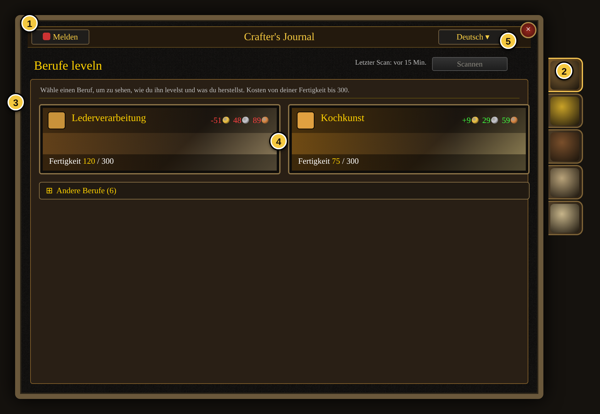
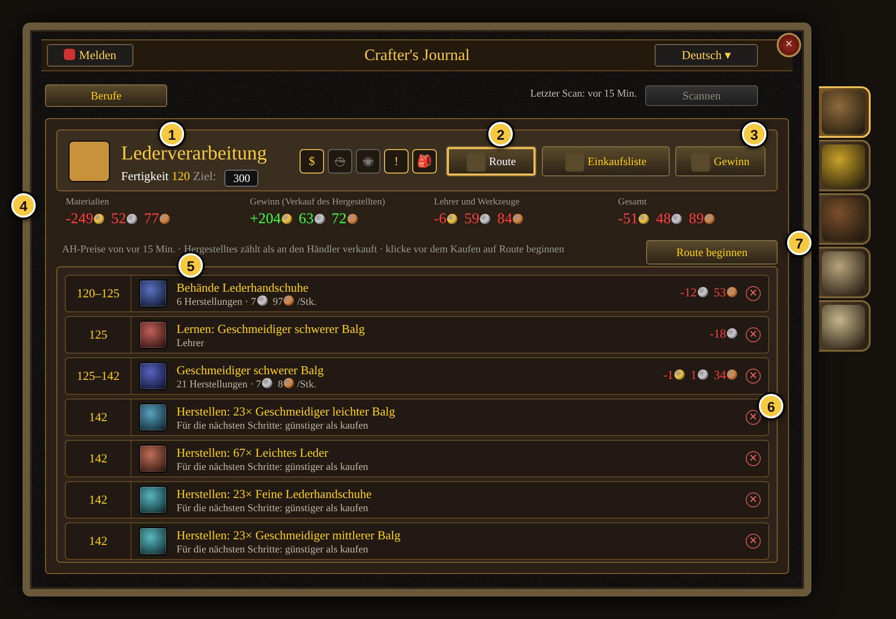
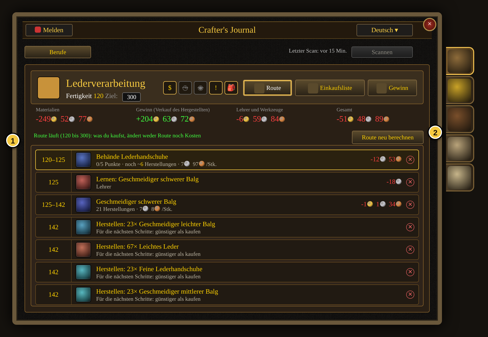
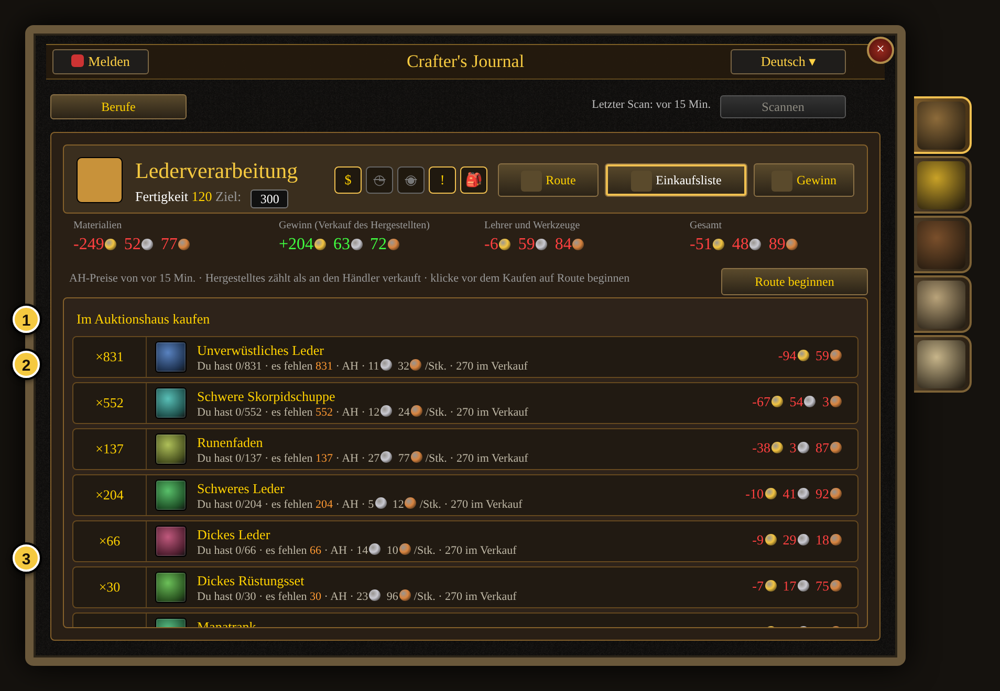
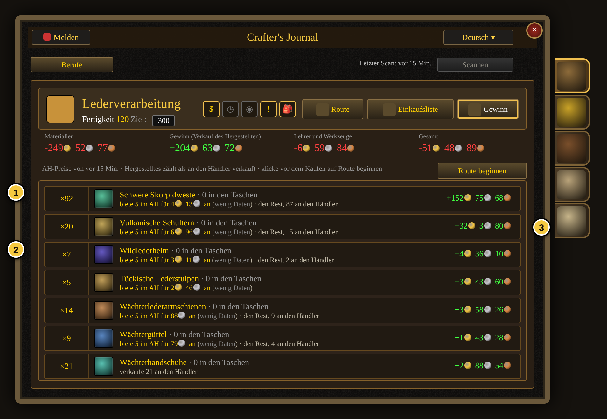
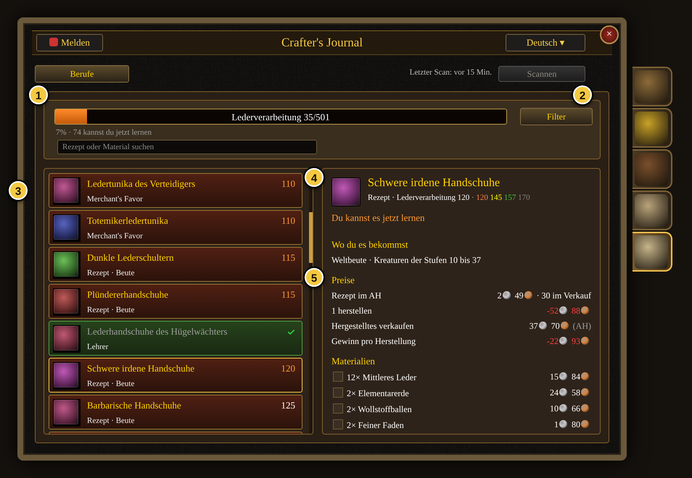
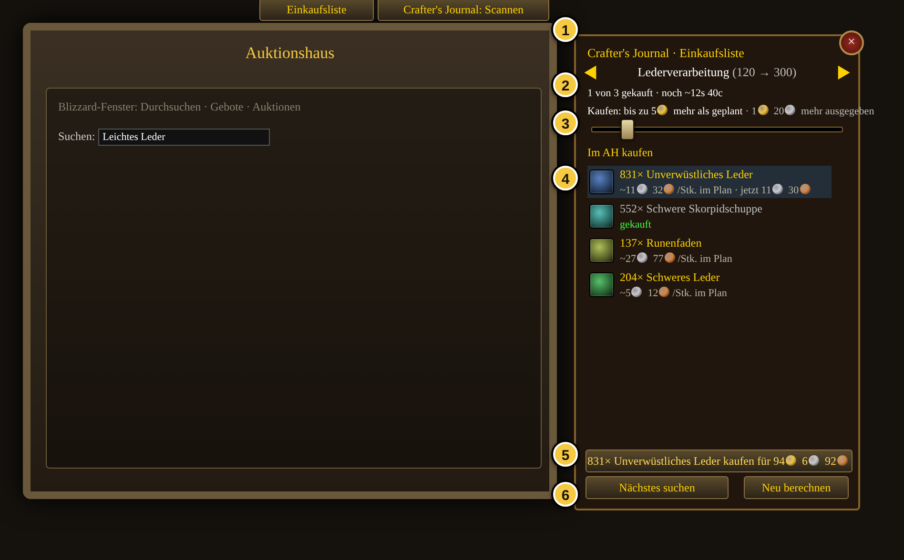
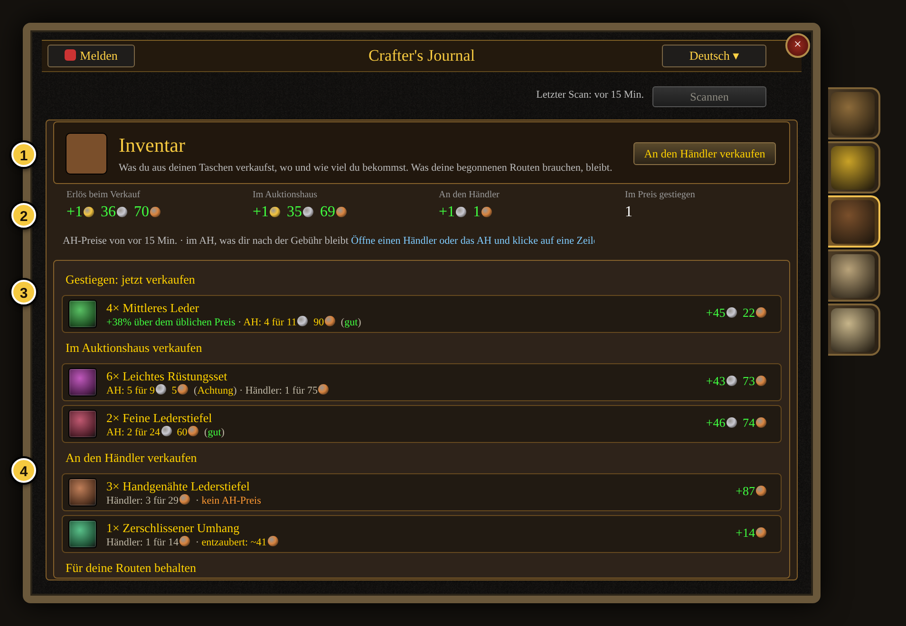
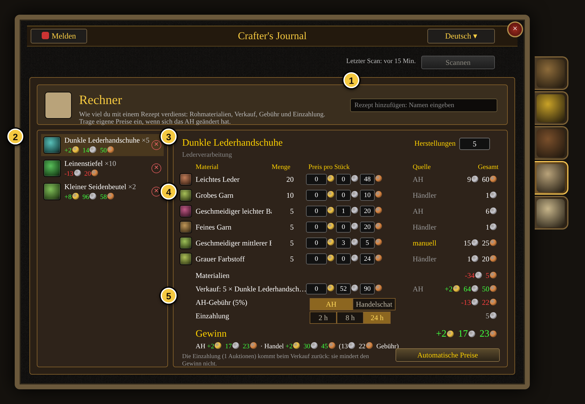

# Crafter's Journal – Anleitung (Deutsch)

Crafter's Journal ist ein AddOn für World of Warcraft: Forever. Es beantwortet drei Fragen zu deinen Berufen:

1. **Wie levle ich einen Beruf am günstigsten?** Das AddOn berechnet eine Route von deiner aktuellen Fertigkeit bis zum Ziel: welches Rezept du wie oft herstellst, was du dafür kaufst und was der Lehrer kostet. Grundlage sind echte Auktionshauspreise aus deinem eigenen Scan.
2. **Was verdiene ich mit meinen Rezepten?** Gewinn pro Herstellung, was du an den Händler oder ins Auktionshaus verkaufst, und ein Rechner zum Durchspielen.
3. **Welche Rezepte fehlen mir und wo bekomme ich sie?** Eine Rezeptsammlung im Stil des Dungeonkompendiums mit Fundort (Lehrer, Händler, Quest, Beute, Ruf, Merchant's Favor) und Wegpunkt.

> **Hinweis zu den Bildern:** Die Abbildungen sind keine Aufnahmen aus dem Spiel. Der Kaufen-Knopf und der Regler im Auktionshaus-Bild sind noch nicht im Spiel getestet. Sie wurden aus dem Code des AddOns nachgebaut (Maße, Farben, Aufbau) und mit den echten deutschen Texten gefüllt, die das AddOn in der Testumgebung mit Beispielpreisen ausgibt. Gegenstandssymbole sind Platzhalter. Im Spiel sieht die Oberfläche in den Details anders aus (Schrift, Symbole, Hintergründe von Blizzard).

## Erste Schritte

1. Addon installieren (Ordner `CraftersJournal` nach `Interface\AddOns`) und einloggen.
2. `/cj` eingeben oder auf den Minimap-Knopf klicken. Das Journal öffnet sich.
3. Zum Auktionshaus gehen und oben rechts auf **Scannen** klicken. Der Server erlaubt einen vollständigen Scan alle 15 Minuten; ein Countdown zeigt, wann der nächste geht. Ohne Scan rechnet das AddOn nur mit Händlerpreisen.
4. Die Sprache stellst du oben rechts um (Deutsch, English, Español). Auf einem deutschen Client ist Deutsch voreingestellt.

## 1. Startseite: Berufe leveln

1. **Kopfzeile.** Links **Melden** (Discord-Link für Fehler), in der Mitte der Titel, rechts die **Sprache**. Darunter **Scannen** mit dem Zeitpunkt des letzten Scans. Der Knopf ist grau, solange kein Auktionshaus offen ist.
2. **Seitenreiter.** Von oben nach unten: Berufe leveln, Gold verdienen, Inventar, Rechner, Rezeptsammlung. Ein Tooltip erklärt jeden Reiter.
3. **Deine Berufe** stehen zuerst. Jede Karte zeigt die Fertigkeit und das Ziel (Standard 300).
4. **Kosten bis zum Ziel.** Rot = das kostet dich die Route unter dem Strich, grün = du machst sogar Gewinn (Kochkunst hier: +9 Gold, weil das Hergestellte mehr bringt als die Zutaten kosten). Hinweise wie „Preise fehlen: scanne das AH“ erscheinen hier.
5. **Andere Berufe** sind eingeklappt; ein Klick zeigt alle acht Berufe, auch die, die der Charakter nicht hat (Route von 1 bis 300).

Ein Klick auf eine Karte öffnet die Berufsseite.

## 2. Berufsseite: die Route

1. **Kopf.** Beruf, aktuelle Fertigkeit (vom Charakter gelesen) und das **Ziel**, das du eintippen kannst (höchstens 300). Eine Änderung berechnet die Route neu.
2. **Filter-Symbole**, von rechts nach links: Taschen (eigene Materialien zuerst verbrauchen), Quest-Rezepte zählen als kostenlos, Merchant's-Favor-Rezepte erlauben, „Weniger Herstellungen“ (zahlt etwas mehr für kürzere Routen), Auktionshaus (aus = nur Händler). Durchgestrichen heißt aus.
3. **Ansichten:** Route, Einkaufsliste, Gewinn.
4. **Zusammenfassung:** Materialien, Gewinn durch den Verkauf des Hergestellten (an den Händler, das ist die sichere Annahme), Lehrer und Werkzeuge, Gesamt.
5. **Die Schritte.** Jede Zeile: Fertigkeitsbereich, Rezept, wie oft du herstellst, Kosten pro Stück und was der Schritt netto kostet. Dazwischen stehen die Lehrer-Zeilen („Lernen: …“, mit Kosten) und Materialien, die du vorher selbst herstellst („Herstellen: 67× Leichtes Leder“), genau an der Stelle, an der du sie brauchst. Ein Tooltip erklärt jeden Schritt, auch warum nicht ein anderes Rezept gewählt wurde.
6. **✕** entfernt ein Rezept aus der Route (zum Beispiel, wenn du ein Rezept nicht holen willst); das AddOn plant mit einem anderen weiter. Über die Zeile „Aus der Route entfernte Rezepte“ holst du alles zurück.
7. **Route beginnen** fixiert die Route (siehe nächster Abschnitt).

Ein Klick auf einen Schritt öffnet das Rezept im Berufsfenster und stellt die fehlende Menge her (abschaltbar in den Addon-Optionen). Ein Klick auf eine Lehrer- oder Händlerzeile setzt einen Wegpunkt zum nächstgelegenen NPC (mit TomTom oder Shortest Path Forever als Pfeil, sonst als Kartenmarkierung) und markiert ihn mit einem Stern.

## 3. Route begonnen

1. Nach **Route beginnen** ändern Käufe die Route und ihre Kosten nicht mehr; der aktuelle Schritt ist hervorgehoben und zeigt, wie viele Punkte und Herstellungen noch fehlen. Erreichte Schritte werden abgehakt. Die Karte auf der Startseite bekommt einen grünen Rand.
2. **Route neu berechnen** gibt die Route wieder frei und plant mit dem, was du jetzt dabeihast. Erscheinen neue Scan-Preise, bietet ein zusätzlicher Knopf **Preise aktualisieren** an, dieselbe Route mit den neuen Preisen zu bewerten.

## 4. Einkaufsliste

1. **Abschnitte:** Im Auktionshaus kaufen, Beim Händler kaufen, Aus deinen Taschen nutzen. Bei begonnener Route kommt „Hast du schon“ dazu.
2. **Menge** für die gesamte Route (bei begonnener Route: nur was ab deiner jetzigen Fertigkeit noch fehlt).
3. **Fortschritt:** „Du hast 0/831 · es fehlen 831“, dazu der geplante Stückpreis und wie viel gerade im Auktionshaus angeboten ist. Mit offenem Auktionshaus öffnet ein Klick den Kauf mit der fehlenden Menge; mit offenem Händler kauft ein Klick die fehlende Menge. Sonst wird der Weg zum nächsten Auktionator oder Händler markiert.

## 5. Gewinn: was mit dem Hergestellten passiert

1. **Menge**, die die Route insgesamt herstellt.
2. **Empfehlung** pro Gegenstand: wie viele du ins Auktionshaus stellst (zu welchem Preis, mit Marktsignal gut / Achtung / wenig Daten), wie viele an den Händler gehen und was du für spätere Schritte behältst. Mit offenem Händler oder Auktionshaus erledigt ein Klick auf die Zeile den Verkauf.
3. **Erlös** beim Verkauf an den Händler. Die Route rechnet immer mit dem Händlerpreis, weil der sicher ist; was das Auktionshaus zusätzlich bringen könnte, steht im Tooltip.

## 6. Rezeptsammlung

1. **Fortschrittsbalken:** gelernte Rezepte von allen, die es im Spiel für deine Fraktion gibt, dazu wie viele du jetzt lernen könntest.
2. **Filter:** Gelernt / Jetzt lernbar / Fehlen mir; nach Quelle (Lehrer, Grundrezept, Quest, Merchant's Favor, Ruf, Händler, Beute); seelengebundene Ergebnisse ausblenden; Sortierung nach Stufe, Rezeptpreis, Gewinn oder „am günstigsten zu bekommen“. Das Suchfeld findet Rezepte und Materialien.
3. **Liste.** Grün mit Haken = gelernt. Orange Stufe = jetzt lernbar. Darunter die Quelle.
4. **Detailkarte** des angeklickten Rezepts: Schwellen (orange/gelb/grün/grau), Status.
5. **Wo du es bekommst** (mit Klick „Auf der Karte markieren“), **Preise** (Rezept im Auktionshaus und beim Händler, Kosten einer Herstellung, Verkaufserlös, Gewinn pro Herstellung, nach wie vielen Herstellungen sich das Rezept bezahlt macht) und **Materialien**.

## 7. Im Auktionshaus

1. **Crafter's Journal: Scannen** liest alle Auktionen ein (ein vollständiger Scan alle 15 Minuten pro Account; andere Addons verbrauchen dieses Limit mit, das AddOn liest deren Scan dann mit). Der Knopf **Einkaufsliste** blendet das Fenster daneben ein oder aus.
2. **Einkaufsfenster:** wählt mit den Pfeilen zwischen deinen begonnenen Routen und dem Tagespaket von „Gold verdienen“; darunter steht, wie viel schon gekauft ist.
3. **Spielraum-Regler:** „Kaufen: bis zu X mehr als geplant“ legt fest, wie viel Gold der Knopf Kaufen für die ganze Route über den geplanten Preis hinaus ausgeben darf. Daneben steht, was du mit dem Knopf bisher mehr oder weniger als geplant ausgegeben hast. Der Regler wird pro Beruf gespeichert. Stellung 0 heißt: nur zum geplanten Preis oder günstiger.
4. **Zeilen:** fehlende Menge, geplanter Preis und der aktuelle Preis. Kostet die fehlende Menge gerade mehr, als Plan plus Spielraum erlauben, wird die Zeile orange und zeigt, um wie viel. Gekauftes wird abgehakt, auch wenn das Spiel es per Post liefert.
5. **Kaufen** kauft mit deinem Klick die fehlende Menge des nächsten Materials, sofern die aktuellen Angebote in Plan plus Spielraum passen. Die Kosten werden über die ganze Menge gerechnet, vom günstigsten Angebot aufwärts, ein einzelnes billiges Angebot vor vielen teuren täuscht also nicht. Der Knopf sagt vorher, was er kaufen würde („831× Unverwüstliches Leder kaufen für 94 G 6 S 92 K“) oder warum nicht („1 G über Plan: Regler erhöhen“). Pro Klick ein Material: Das Spiel erlaubt Käufe im Auktionshaus nur als Antwort auf einen Klick, nie aus einem Timer. Der Kauf läuft in zwei Schritten, der Server nennt den echten Preis, dann wird bestätigt. Passt der Preis noch in den Spielraum, bestätigt das AddOn selbst; verlangt das Spiel dafür einen weiteren Klick, wird der Knopf zu „Bestätigen“. Das AddOn kauft nie ohne deinen Klick.
6. **Nächstes suchen** öffnet wie bisher die Kaufseite von Blizzard mit der passenden Menge, falls du selbst kaufen willst. **Neu berechnen** plant die Liste mit den aktuellen Taschen und Scan-Preisen neu.

Auch beim Händler erscheint ein kleines Fenster, sobald er etwas von deiner Einkaufsliste führt: „Alles kaufen“ kauft die fehlenden Mengen, „Alles verkaufen“ verkauft, was die Gewinn-Ansicht für den Händler vorsieht.

## 8. Inventar

1. **Inventar** zeigt, was du aus den Taschen verkaufen solltest, wo und für wie viel. Der Knopf oben rechts verkauft bei offenem Händler alles, was zum Händler soll.
2. **Summen:** Erlös gesamt, davon Auktionshaus und Händler, und wie viele Gegenstände gerade im Preis gestiegen sind.
3. **Gestiegen: jetzt verkaufen** listet, was deutlich über seinem üblichen Preis liegt. Danach „Im Auktionshaus verkaufen“ (nach Gebühr; bei unsicherem Markt nur wenige, der Rest zum Händler) und „An den Händler verkaufen“ (auch mit Hinweis, wenn Entzaubern mehr brächte).
4. **Für deine Routen behalten:** Was eine begonnene Route noch braucht, wird nicht zum Verkauf vorgeschlagen.

## 9. Rechner

1. **Rezept hinzufügen:** Name eintippen, Treffer anklicken. Eigene Rezepte stehen oben.
2. **Gespeicherte Berechnungen** mit Gewinn; ✕ löscht.
3. **Herstellungen:** wie oft du das Rezept machst. Zwischenprodukte, die du selbst kennst (hier Feine Lederhandschuhe), werden bis auf die Rohmaterialien aufgeschlüsselt.
4. **Preis pro Stück** in Gold/Silber/Kupfer-Feldern: automatisch der günstigere Preis von Auktionshaus (letzter Scan) und Händler (mit deinem Rufrabatt in der Hauptstadt); eigene Werte überschreiben ihn für diese Berechnung („manuell“). „Automatische Preise“ setzt alles zurück.
5. **Verkauf, Gebühr, Einzahlung, Gewinn.** Umschaltbar zwischen Auktionshaus (5 % Gebühr, Einzahlung je nach Laufzeit 2/8/24 h) und Handelschat (keine Gebühr); beide Gewinne stehen zum Vergleich darunter. Die Einzahlung kommt beim Verkauf zurück und mindert den Gewinn nicht.

## Gold verdienen

Der Reiter **Gold verdienen** (ohne Bild) nimmt die Rezepte, die dein Charakter kennt, und zeigt mit den Preisen des letzten Scans, was sich herzustellen lohnt: ein „Tagespaket“ von bis zu acht Rezepten mit Investition und Gewinn, weitere Optionen, Rezepte mit Abklingzeit (Transmutationen, Mondstoff) mit Restzeit, und Materialien in den Taschen, die keines deiner Rezepte braucht. Die Menge pro Rezept richtet sich nach dem Marktsignal: bei „gut“ bis zu 30 % des aktuellen Angebots, bei unsicherem Markt nur ein paar zum Testen.

## Wie das AddOn die günstigste Route findet

- Für jeden Fertigkeitspunkt kostet ein Rezept „erwartete Herstellungen × (Materialien − Händlererlös)“. Die erwarteten Herstellungen folgen der Farbe: orange und gelb geben sicher einen Punkt, grün immer seltener, grau nie.
- Lehrerkosten und Werkzeuge (Runenstäbe, Schmiedehammer) werden einmal gezahlt, wo die Route sie zuerst braucht.
- Materialien kommen in dieser Reihenfolge: aus deinen Taschen (falls eingeschaltet), aus dem, was frühere Schritte hergestellt haben, vom Händler, aus dem Auktionshaus (Angebot für Angebot vom günstigsten aufwärts, die Preisstaffel wird berücksichtigt) oder selbst hergestellt, wenn das billiger ist.
- Der Planer sucht wie ein Navigationsgerät die kürzeste Strecke über alle Fertigkeitsstufen, probiert vollständige Routen durch, verfeinert die beste (Grenzen verschieben, Rezepte tauschen, herstellen oder kaufen) und nimmt die günstigste. Zwei kleine Zuschläge (5 Kupfer je Herstellung, 1 Silber je Routenschritt) sorgen dafür, dass er bei praktisch gleichen Kosten die Route mit weniger Klicks bevorzugt. Rezepte mit Abklingzeit (Transmutationen, Mondstoff, Lagerfeuer) werden nicht zum Leveln benutzt.
- Hergestelltes wird immer zum Händlerpreis gerechnet. Was das Auktionshaus zusätzlich bringen könnte, zeigen Tooltips und die Gewinn-Ansicht, denn ob und wann es sich verkauft, kann niemand garantieren.

## Befehle

| Befehl | Wirkung |
| --- | --- |
| `/cj` | Journal öffnen oder schließen |
| `/cj scan` | Auktionshaus scannen (bei offenem AH) |
| `/cj cancel` | laufenden Scan abbrechen |
| `/cj minimap` | Minimap-Knopf ein- oder ausblenden |
| `/cj fehler` | protokollierte Fehler des AddOns anzeigen (`/cj fehler leeren` löscht sie) |

Optionen findest du außerdem unter Spiel-Optionen → AddOns → Crafter's Journal (dort lässt sich das automatische Herstellen beim Klick auf einen Schritt abschalten).
